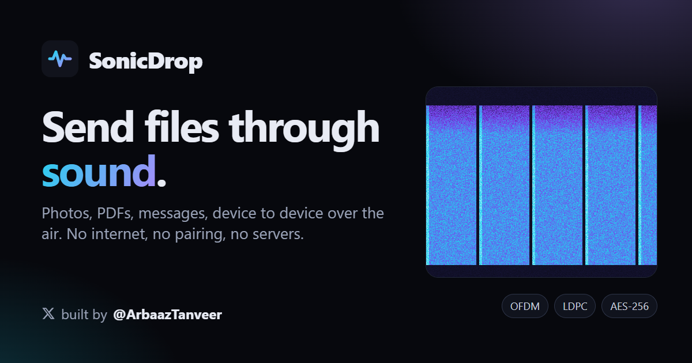

# SonicDrop

**Send files through sound.** One device plays the data out of its speaker and another records it with its microphone, then rebuilds the file bit for bit. No internet, Bluetooth, pairing, accounts or app install. It is a static web page; all processing happens in your browser.

**Try it:** https://sonicdrop.arbaazt.workers.dev &nbsp;·&nbsp; built by [@ArbaazTanveer](https://x.com/ArbaazTanveer)



- **Any file:** photos, PDFs, documents and text messages, several at once. Photos can be shrunk automatically before sending.
- **Up to ~17 kbps over the air,** over 100× the 8–16 bytes/s of ggwave. Four speed modes, plus a built-in **speed test** that measures your two devices in your room and tells you which mode to use.
- **Join any time:** fountain coding means the receiver can start listening mid-transfer, and lost frames never need a resend.
- **Private and safe:** nothing touches a server, and the page's Content-Security-Policy forbids network requests. Optional AES-256-GCM encryption with a passphrase. A SHA-256 check proves the received file is an exact copy.
- **Live view:** spectrogram, live transfer speed, signal quality, constellation diagram, per-frequency SNR and a block-by-block progress grid.
- **One file:** the whole app builds into a single ~160 KB HTML file that works offline, even opened straight from disk on an air-gapped machine.

---

## Contents

- [Quick start](#quick-start)
- [Using it](#using-it)
- [Speed modes](#speed-modes)
- [How it works](#how-it-works)
- [Security and privacy](#security-and-privacy)
- [Browser support and limitations](#browser-support-and-limitations)
- [Development](#development)
- [Debugging a real-world transfer](#debugging-a-real-world-transfer)
- [Deploying](#deploying)
- [Prior art](#prior-art)
- [License](#license)

## Quick start

**Hosted:** open https://sonicdrop.arbaazt.workers.dev on both devices.

**Run locally** (Node 18+, no dependencies to install):

```bash
git clone https://github.com/Arbaaz-Tanveer/sonicdrop.git
cd sonicdrop
node build.mjs            # -> dist/index.html (single self-contained file)
node serve.mjs            # http://localhost:8080
node serve.mjs --https    # also https://<LAN-IP>:8443 for phones on the same Wi-Fi
```

**Single file:** `dist/index.html` is the complete app. Copy it anywhere and open it in a browser; no server needed.

Browsers only allow the **microphone on `https://` pages or `localhost`**. Sending works from any page, but a phone that receives needs an https URL: the hosted site, `serve.mjs --https` (accept the self-signed certificate once), or your own static host.

## Using it

1. On the receiving device tap **Receive → Start listening** and allow the microphone.
2. On the sending device tap **Send**, choose files or type a message, pick a speed and tap **Transmit**.
3. Keep the devices close and still. The file appears on the receiver with a *SHA-256 verified* badge. Tap an image to view it full screen, then **Download** or **Share** it.

The sender keeps transmitting until you stop it. It sends every block once, then an endless stream of repair packets, so receivers can join late. A receiver normally finishes after about 100–110% of one full pass.

**Speed test:** one device taps **Speed test → Play test signal**, the other taps **Measure**. The measuring device shows which speeds made it through and recommends one. Select that speed on the sending device.

**Tips for speed:** rest both devices on a table (hand movement costs the most), point the sender's speaker at the receiver's microphone 20–40 cm away, raise the volume and pick a quiet spot.

## Speed modes

| Mode | Modulation | LDPC code rate | Net speed | Typical use |
|---|---|---|---|---|
| Ultra-robust | BPSK | 1/2 | 4.0 kbps | far away or noisy |
| Robust | QPSK | 1/2 | 8.0 kbps | across a room |
| Normal | QPSK | 2/3 | 10.7 kbps | 1–2 m |
| Quick | 16-QAM | 1/2 | 16.8 kbps | about 1 m, devices held still |

The speeds are net payload after all coding overhead. The receiver detects the mode automatically.

**Field results so far:** the first real phone-to-laptop test, hand-held in a furnished room, measured about 10 dB SNR and topped out around 8–10 kbps. The analysis of that recording (see [Debugging](#debugging-a-real-world-transfer)) found echoes arriving 11–13 ms late, a dead band above ~13 kHz from the phone speaker, hand movement, and a header bug. The current protocol (v2) fixes all four. In a simulator replaying that room's measured echo profile, Quick delivers about 10–11 kbps hand-held and about 17 kbps with the devices resting still.

## How it works

```
 SENDER                                                     RECEIVER
 files + message                                            microphone (any sample rate)
   │ container: deflate · AES-256-GCM · SHA-256                │ resample to 48 kHz
   ▼                                                           ▼
 fountain encoder  ──►  packets + CRC-32                    frame sync (matched filter)
   ▼                                                           ▼
 LDPC encoder  ──►  interleave + whiten                     channel estimate (2 training symbols)
   ▼                                                           ▼
 QAM mapping onto 576 data tones + 53 pilot tones           drift / phase / gain / noise tracking
   ▼                                                           ▼
 OFDM (IFFT, cyclic prefix, raised-cosine edges)            soft demapping (LLRs) ─► LDPC decode
   ▼                                                           ▼
 speaker  ~~~~~~~~~~~~~~~~~~  sound through the air  ~~~►   fountain decode ─► unpack ─► verify SHA-256
```

All the signal processing runs in a Web Worker, so the page stays smooth while decoding.

### 1. Packaging (`src/core/container.js`)

Selected files and the optional message are concatenated with a small JSON header (names, types, sizes, SHA-256 of the content). The payload is compressed with `deflate-raw` when that helps. With a passphrase, the whole thing is encrypted with AES-256-GCM, using a key derived by PBKDF2-SHA-256 (250,000 iterations, random salt and IV). GCM also authenticates, so a wrong passphrase or tampered data is detected.

### 2. Fountain code (`src/core/fountain.js`)

The container is cut into K blocks (140–188 bytes depending on the mode). Packet ids `0..K-1` are the blocks themselves (systematic). Every id `≥ K` is a random XOR of about half of all blocks, with the coefficients derived from a seeded PRNG so both sides agree without sending them. The receiver runs incremental Gaussian elimination over GF(2): **any K independent packets rebuild the file**, typically with zero or one extra packet. That is why the receiver can join late and why lost frames don't matter.

### 3. Packets and error correction (`src/core/ldpc.js`)

Each packet becomes one codeword: payload + CRC-32 (keyed with the session and packet id), encoded with an **LDPC code** (n = 2304, rate 1/2 or 2/3). These are irregular repeat-accumulate codes: linear-time encoding, with parity-check matrices built deterministically from a seed so every device constructs the identical code. Decoding is layered normalized min-sum belief propagation with early stopping. At rate 1/2 it decodes reliably about 2 dB above the Shannon limit, comparable to Wi-Fi's LDPC codes.

### 4. OFDM modem (`src/core/modem.js`, `src/core/params.js`)

| Parameter | Value |
|---|---|
| Sample rate | 48 kHz (receivers at other rates are resampled) |
| FFT size | 2048 → 23.4 Hz tone spacing |
| Band | 629 tones from 1.1 kHz to 15.8 kHz: 576 data tones, 53 pilots |
| Cyclic prefix | 768 samples (16 ms), sized from measured room echoes |
| Frame | sync + training + header + 16–24 data symbols (≈1.1–1.6 s) |

```
 ┌──────┬───────┬────────┬──────┬──────┬─────┬──────┐
 │ sync │ train │ header │ data │ data │ ... │ data │  10 ms gap  → next frame
 └──────┴───────┴────────┴──────┴──────┴─────┴──────┘
  each symbol = 16 ms cyclic prefix + 42.7 ms body, joined with raised-cosine edges
```

- **Sync and training symbols** are known pseudo-random QPSK patterns. The receiver finds each frame with a normalized matched filter, locks onto the first strong arrival, and estimates the channel on every tone from the two training symbols. The difference between those two estimates gives the noise level per tone and the clock drift between the two devices.
- **Header** (mode, session id, block count, packet id) is BPSK with a rate-1/4 LDPC code and CRC-16, scattered over all tones so a weak band cannot break it.
- **Data symbols** carry BPSK to 16-QAM (Gray-coded). Each codeword is spread over every tone but kept within a 1–4 symbol slot, so a fade from hand movement only costs the codewords it hits. A fixed pseudo-random whitening sequence avoids tonal patterns.
- **Pilots** on every 12th tone are used every symbol to track:
  - **Clock drift:** a PI loop on the phase slope across the band. Devices disagree by tens of ppm, and the loop has been tested to ±250 ppm.
  - **Common phase and gain.**
  - **Per-band channel changes and per-band noise:** movement affects each frequency differently.

  Decision-directed updates refine every tone's channel estimate in between.
- **Soft demapping** turns each received point into log-likelihood ratios weighted by that tone's measured SNR. Tones near a speaker's roll-off or in an echo notch then count for little instead of corrupting the decode.

### 5. Assembling the file

Codewords that decode and pass their CRC feed the fountain decoder. Once it has K independent packets it solves for the blocks. The container is then decrypted (if needed), decompressed and checked against its SHA-256 before anything is shown.

## Security and privacy

**What stays private:** SonicDrop has no backend. The built page sets `connect-src 'none'`, so it cannot make network requests. Audio and files never leave the two devices except as sound. The microphone is used only on the Receive screen.

**Anyone nearby can listen.** Sound is a broadcast medium, so anything sent without a passphrase can be recorded and decoded by any device in earshot. Use a passphrase for anything sensitive. Contents and file names are then protected with AES-256-GCM, and only the transfer's size and timing are visible.

**Anyone nearby can transmit.** A receiver accepts transfers from whoever is playing them. The receiver is hardened against hostile transmissions:

- **Untrusted file types:** a received file keeps its MIME type only if it is a known passive type (raster images, PDF, text, audio/video, office documents). HTML, SVG and anything else become plain downloads, so they can never render inside the app's origin.
- **Memory caps:** block counts are capped (about 5 MB per transfer) and so is the number of simultaneous transfers, so a fake header cannot exhaust memory.
- **Decompression bombs:** decompression stops at the declared size.
- **PBKDF2 cost:** the iteration count comes from the sender, so it is bounded to stop a hostile value from freezing the tab.
- **Malformed data:** headers (CRC-16), packets (CRC-32, keyed by session and packet id), container metadata and speed-test fields are all validated.
- **Download names:** file names are length-limited, and browsers sanitise them when saving.
- Still, only open received files you were expecting.

**Content-Security-Policy:**
- Only the app's own inline scripts can run; the policy lists their exact SHA-256 hashes, with no `unsafe-inline` for scripts.
- No network access (`connect-src 'none'`).
- No framing, forms or base-URI changes.
- The Cloudflare deployment adds HSTS, `X-Content-Type-Options`, `Referrer-Policy: no-referrer` and a Permissions-Policy that allows only the microphone.

**No dependencies:** the app and its build use only browser APIs and Node's standard library, so there is no third-party code to audit.

`node test/security.cjs` exercises the hostile-input cases, and `node test/csp-check.mjs` confirms the page boots under its policy.

Found a vulnerability? Please open a GitHub issue, or for anything sensitive contact [@ArbaazTanveer](https://x.com/ArbaazTanveer) on X.

## Browser support and limitations

- **Supported browsers:** recent Chrome, Edge, Firefox and Safari, on desktop and mobile. Receiving needs `getUserMedia` (https or localhost) and, ideally, AudioWorklet. A ScriptProcessor fallback covers pages opened from disk.
- **Keep both screens on and the page in front** while transferring. The app requests a wake lock where supported, but mobile browsers may pause audio in background tabs.
- **Audio processing:** the receiver asks the browser to turn off echo cancellation, noise suppression and auto-gain. Some devices ignore that, and the Signal details panel shows when they do.
- **Speed limits:** phone speakers are weak above ~13 kHz and rooms echo, which caps practical over-the-air speeds well below what the modem can do over a cable. The faster modes (16-QAM 2/3 up to 256-QAM, up to ~58 kbps) were removed from the app for that reason. They are a one-line change in `src/core/params.js` if you want to experiment, for example with an audio cable.
- **Size limit:** about 5 MB per transfer, which is already about 40 minutes at Quick. Photos are best sent with the built-in "Medium" resize.

## Development

Everything is plain JavaScript with no build dependencies. The DSP files in `src/core/` are classic scripts that attach to `globalThis.SD`, so the same code runs in the page, the Web Worker and the Node tests.

```
src/core/          params, fft, ldpc, qam, modem (TX + RX), resampler, fountain, container, util
src/app/           UI (app.js, style.css)
src/engine-worker.js     all signal processing, off the UI thread
src/capture-worklet.js   microphone capture
src/index.html     page markup (development entry: node serve.mjs --dev)
build.mjs          bundles everything into dist/ (single HTML file + _headers, sw.js, manifest, og.png)
serve.mjs          local http/https static server
tools/             link-preview card renderer
test/              simulators, benchmarks, browser end-to-end tests
```

```bash
node serve.mjs --dev            # serve src/ directly while editing

# signal processing (Node)
node test/ldpc-bench.cjs        # LDPC block error rate vs Eb/N0
node test/matrix.cjs            # every mode x near / mid / far / cable simulated rooms
node test/robust.cjs            # late join, ±250 ppm clocks, 32/96 kHz mics, noise bursts, quiet sender
node test/room-sim.cjs room1    # every mode over a replica of a real, measured room
node test/container.cjs         # packaging, compression, encryption round trips
node test/security.cjs          # hostile inputs: zip bomb, PBKDF2 cost, malformed data, tampering

# real browser (headless Edge/Chrome over the DevTools protocol)
node test/csp-check.mjs         # built page boots under its CSP
node test/browser-e2e.mjs 3 near [--pass=secret] [--speedtest] [--file] [--phone]
node test/phone-layout.mjs      # phone viewport: monitor first, files, image viewer, delete / clear all
node test/screens.mjs           # screenshots of every screen
```

The channel simulator (`test/sim-lib.cjs`) models room reverb (RT60, direct-to-reverberant ratio, early reflections), speaker and microphone band-limiting, noise, sample-rate conversion and clock offset. It can also replay real rooms measured from recordings (`test/rooms/*.json`).

## Debugging a real-world transfer

On the receiver open **Signal details → Save last 30 s of mic audio**, then:

```bash
node test/decode-wav.cjs recording.wav [passphrase]   # per-frame SNR, error rates, clock offset, SNR per band
node test/delay-profile.cjs recording.wav             # how much echo arrives after each delay
node test/extract-room.cjs recording.wav myroom       # turn it into a room replica for the simulator
node test/room-sim.cjs myroom                         # try every mode against that room
```

`delay-profile.cjs` and `extract-room.cjs` default to protocol-v1 recordings (`test/legacy-v1.cjs`). Remove that `require` line for recordings made with the current version. This workflow found the v2 improvements.

## Deploying

`dist/` is a fully static site; any static host works. For Cloudflare Workers static assets (`wrangler.jsonc`):

```bash
SITE_URL=https://your-domain.example node build.mjs   # SITE_URL sets the link-preview URLs
npx wrangler deploy
```

`dist/_headers` carries the security and caching headers. A small service worker lets the hosted app keep working offline after the first visit.

## Prior art

- [ggwave](https://github.com/ggerganov/ggwave): robust data-over-sound library, about 8–16 bytes/s.
- [Quiet / quiet-js](https://github.com/quiet/quiet-js): reports about 7 kbps audible over the air and higher over a cable.
- [amodem](https://github.com/romanz/amodem): high-rate audio modem for cable links.

SonicDrop's contribution is a complete browser-only pipeline for files: capacity-approaching LDPC, fountain coding for join-any-time transfers, drift and movement tracking tuned on real recordings, encryption and integrity, all in one dependency-free static page.

## License

[MIT](LICENSE) © 2026 Arbaaz Tanveer
